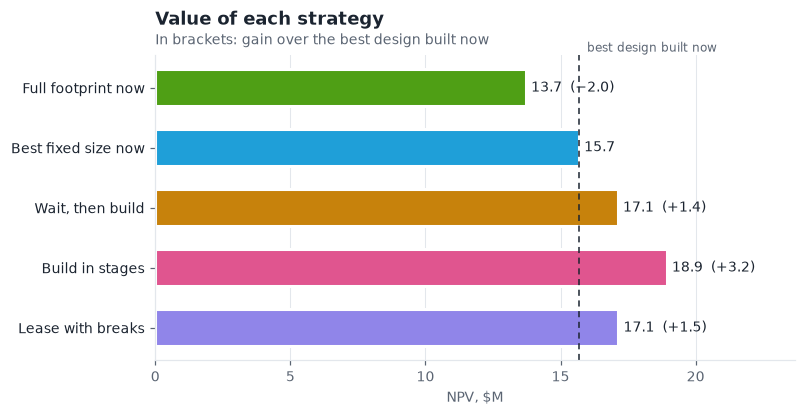
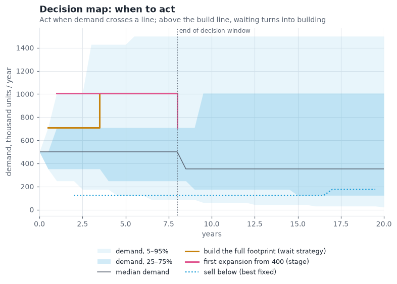
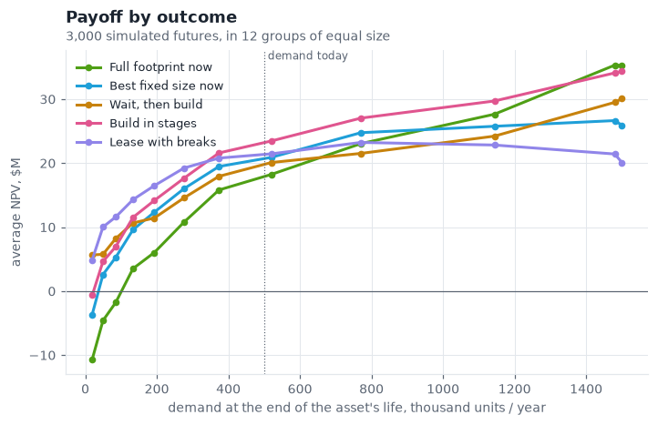
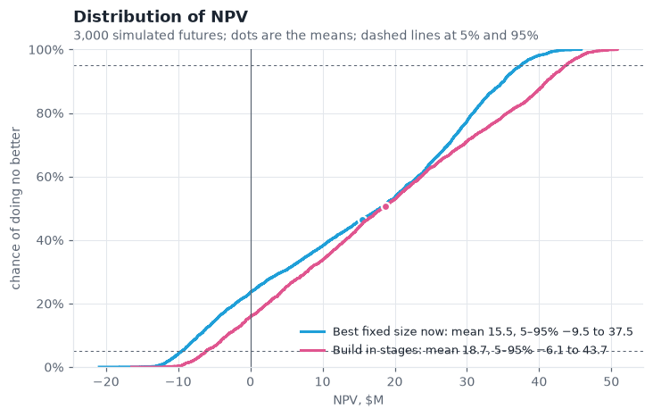
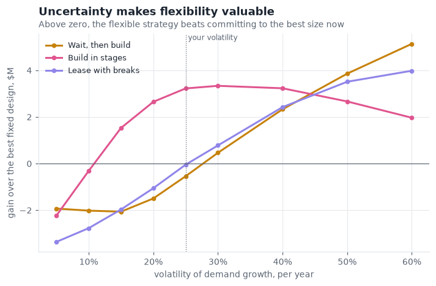
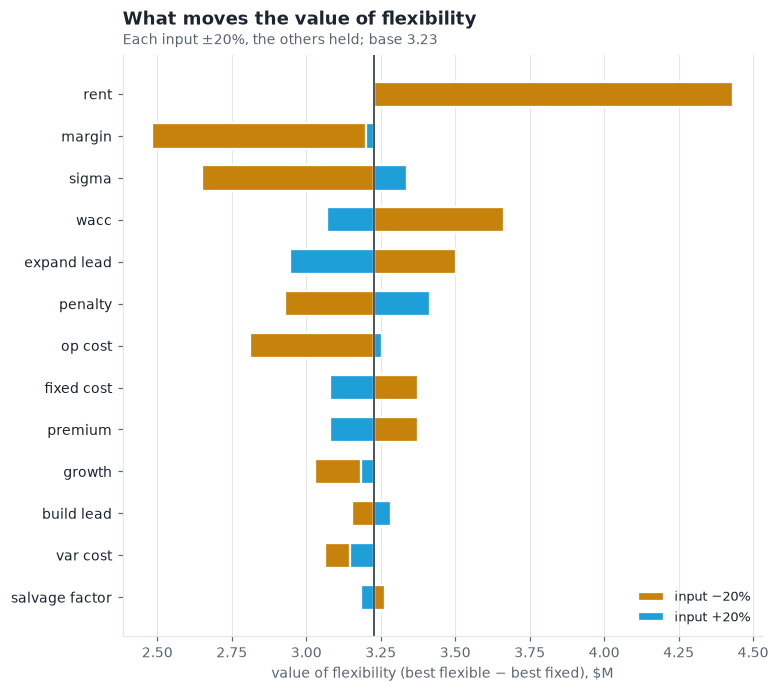
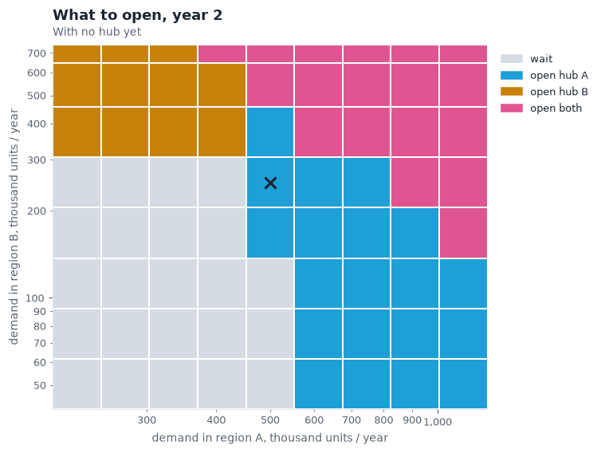
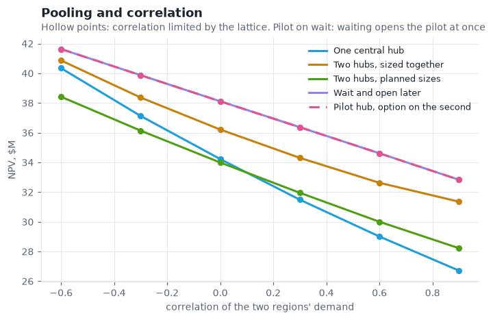
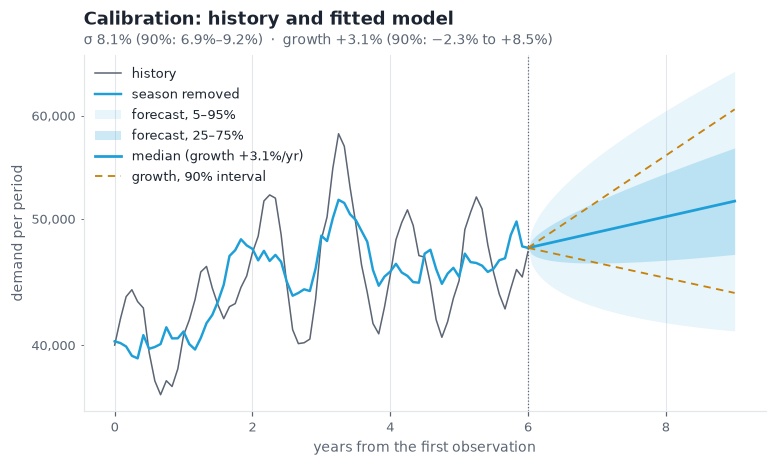

# supplyflex

Valuing flexibility in supply-chain capacity and network decisions.

Should you build the full site now, build small and expand, wait, or lease with break clauses? One hub or two, now or
later? Discounted cash flow values a commitment; `supplyflex` values the **choices you keep**: to wait, to expand, to
sell, to idle a site, to hand a lease back, to open a second hub once the first proves itself. It returns the value of
each strategy, what each kind of flexibility is worth, and the policy behind it, such as the demand at which waiting
turns into building.

Python has good libraries for option pricing (financial derivatives), inventory, network optimisation and simulation,
but none for real options on supply-chain capacity. `supplyflex` fills that gap. Its engines are ports of the web app
[Real Options for Network Design](https://kathuman.github.io/claude-projects/real-options/), and the tests check that
both give the same numbers.

> Status: 0.2, alpha. The API may still change before 1.0.

## Install

```
pip install git+https://github.com/kathuman/supplyflex
```

Python 3.10 or later; the only dependency is NumPy. For the charts, add Matplotlib:

```
pip install "supplyflex[plot] @ git+https://github.com/kathuman/supplyflex"
```

## Quick start

```python
from supplyflex import site

sol = site.solve(sigma=0.35)       # the defaults, with 35% demand volatility
sol.npvs()
# {'full': 13.72, 'best': 15.68, 'defer': 17.12, 'stage': 18.93, 'lease': 17.14}   ($M)

sol.option_values()                # each kind of flexibility, against the best fixed design
# {'wait': 1.44, 'stage': 3.25, 'lease': 1.46, 'break_clauses': 3.45, 'sell': 2.05, 'mothball': 0.0}

sol.defer_triggers()[:4]           # when waiting turns into building: the lowest demand, step by step
# [{'year': 0.0, 'build_at_demand': None}, {'year': 0.25, 'build_at_demand': None},
#  {'year': 0.5, 'build_at_demand': 709.5}, {'year': 0.75, 'build_at_demand': 845.2}]
```

Two regions with correlated demand:

```python
from supplyflex import network

net = network.solve(rho=0.8)
net.npvs()
# {'central': 27.48, 'two': 31.73, 'both': 28.78, 'pilot': 33.42, 'wait': 33.42}
net.pilot.region   # 'A': open the first hub in region A, keep the option on B
```

From a demand history to the model's inputs, with how uncertain each estimate is:

```python
from supplyflex import calibrate, site

est = calibrate.estimate(monthly_demand_in_units, 12, deseason=True, scale=1000)
est.sigma, est.ci_sigma      # e.g. 0.323, (0.274, 0.372)
est.growth, est.ci_growth    # growth is far less certain: e.g. 0.019, (-0.219, 0.257)
site.solve(**est.site_inputs())
```

Units throughout: money in $M, demand and capacity in thousand units per year, margins in $M per thousand units.
Inputs are checked when they are set: anything out of range raises one `ValueError` that lists every problem.

## Documentation

- [Getting started](https://github.com/kathuman/supplyflex/blob/main/docs/getting-started.md): the questions it answers, the data and figures to bring (and in
  what format), and the workflow from history to decision, with an [input template](https://github.com/kathuman/supplyflex/blob/main/examples/inputs_template.py)
  in everyday units.
- [Worked example](https://github.com/kathuman/supplyflex/blob/main/docs/worked-example.md): a regional distribution centre, from five years of monthly shipments to a
  recommendation, a decision rule to monitor and the inputs it depends on
  ([script](https://github.com/kathuman/supplyflex/blob/main/examples/regional_dc.py)).
- [User guide](https://github.com/kathuman/supplyflex/blob/main/docs/guide.md): a workflow, how to read every result (option values do not add up, and why `wait` can
  be negative), choosing inputs, the valuation basis, assumptions and limitations, and references.
- [Parameter reference](https://github.com/kathuman/supplyflex/blob/main/docs/parameters.md): every input with its default, units, valid range and where to get a value.

## Charts

`supplyflex.plots` draws the views a decision needs. Each function returns the figure, the axes and the numbers
behind the chart (`.data`), takes an `ax=` to place it in your own figure, and `.save(path)` writes it out. Each strategy
keeps one colour everywhere, from a palette checked for colour-blind separation; `plots.set_theme("dark")` switches
theme.

```python
from supplyflex import plots, site

sol = site.solve(sigma=0.35)
plots.decision_map(sol).save("decision_map.png")
plots.npv_distribution(sol).data["stats"]   # mean, 5%, 95% and the chance of a loss, per strategy
```

| Question | Function | |
|---|---|---|
| Which strategy, and by how much? | `strategy_values(sol)` (site or network) |  |
| At what demand do I act, and when? | `decision_map(sol)` |  |
| In which futures does flexibility pay? | `payoff_by_outcome(sol)` |  |
| What is the downside? | `npv_distribution(sol)` (site or network) |  |
| Why is flexibility worth anything? | `flexibility_vs_volatility(params)` |  |
| What should I check first? | `tornado(params)` |  |
| What do I open, and where? | `network_decision_map(sol, year)` |  |
| One hub or two? | `pooling(params)` |  |
| How sure are my inputs? | `calibration(values, f)` |  |

The gallery is drawn by `tools/make_gallery.py`.

## What is modelled

**One site** (`supplyflex.site`): demand on a recombining binomial lattice over the asset's life; decisions only
inside a decision window; build and expansion lead times; a 3PL that serves unmet demand up to a limit at a lower
margin, the rest lost with a penalty. Strategies:

| Strategy | Meaning |
|---|---|
| `full` | build the full footprint now and keep it |
| `best` | build the capacity that maximises NPV now (the fair fixed benchmark) |
| `defer` | build the full footprint once, at the best moment inside the window |
| `stage` | build the initial footprint now, then expand in steps where it pays |
| `lease` | lease capacity, with break clauses at set dates |

Owned sites can be sold (resale value declining over the asset's life), mothballed and reactivated, and the staged
site can sell capacity back in steps. Valuation on expected cash flows at the WACC, or risk-neutral.

**Two regions** (`supplyflex.network`): correlated demand on a joint lattice (four branches per step); a hub serves its
own region first and its spare capacity the other region at a transport cost; a cheaper second hub (learning). Strategies:
one central hub, two hubs sized together, both at planned sizes, a pilot hub with the option on the second, and waiting.

**Calibration** (`supplyflex.calibrate`): volatility and growth from a history (weekly, monthly, quarterly or yearly),
season removal, 90% intervals, warnings for short, seasonal or autocorrelated data; parsing pasted CSV text.

Every solution can be **simulated** along its optimal policies (`sol.simulate(n, seed)`), and the simulated paths
average to the lattice values.

## How we know it is right

- **Parity with the web app**: `tests/fixtures/parity.json` holds values from the JavaScript engine (written by
  `tools/make_fixtures.js`) for 17 single-site cases, 7 network cases, fixed designs, leases, simulated paths and
  calibration; supplyflex matches every one to a relative 1e-9, and draws the same simulated paths for a seed.
- **Behaviour**: the lattice prices a European call within 0.5% of Black–Scholes; deterministic cases equal their
  discounted cash flows; waiting is never worth less than committing; option values rise with volatility (risk
  neutral); the right to sell, mothball or break never lowers value; mothballing shows hysteresis; with free switching
  a site equals the closed-form expected best of running and idling; simulated policies match lattice values within
  three standard errors; a two-region network with one empty region is the single-site model.

```
pip install -e .[test,plot]
pytest
```

The chart tests check that every chart's numbers are the model's own: the decision map's build line is the wait
policy, the payoff bins average to the simulated means, the network map is the waiting policy at that year, and so on.

## Roadmap

| Version | Adds |
|---|---|
| 0.2 | Charts for every model (this release) |
| 0.3 | Least-squares Monte Carlo: more than two sites, and demand that mean-reverts or switches regimes, checked against the lattice where both apply |
| 0.4 | Options on a network: each scenario's operations solved as a linear program (HiGHS), with receipts that prove each answer |
| 0.5 | Resilience: time to survive and time to recover, every site in turn, the worst combination of failures |

## Licence

MIT. Written by Daniel Alberto Sepulveda Estay.
