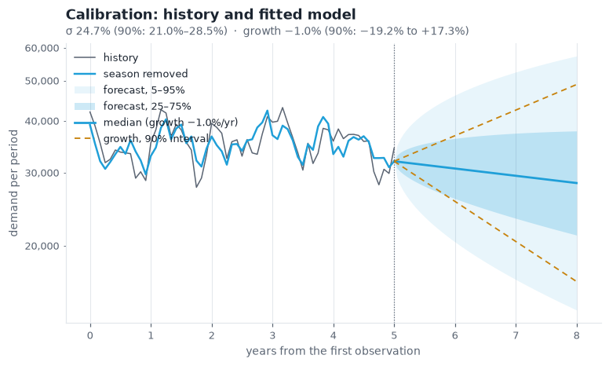
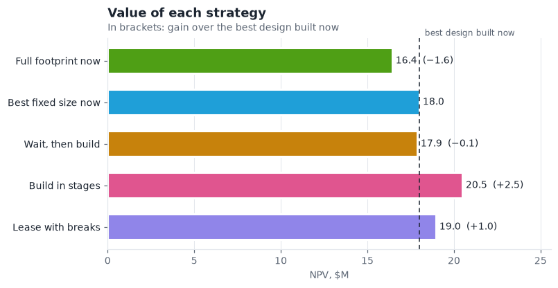
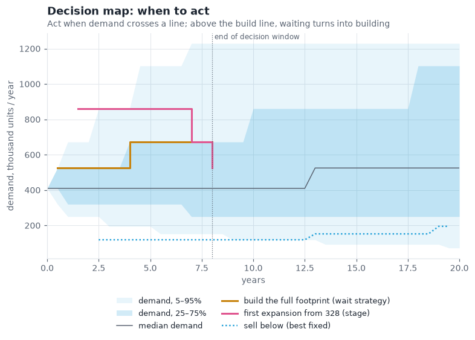
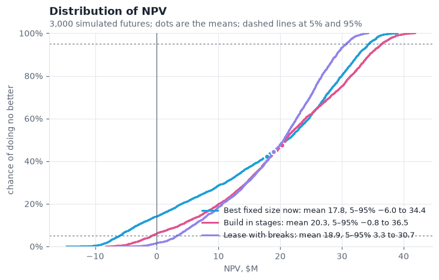
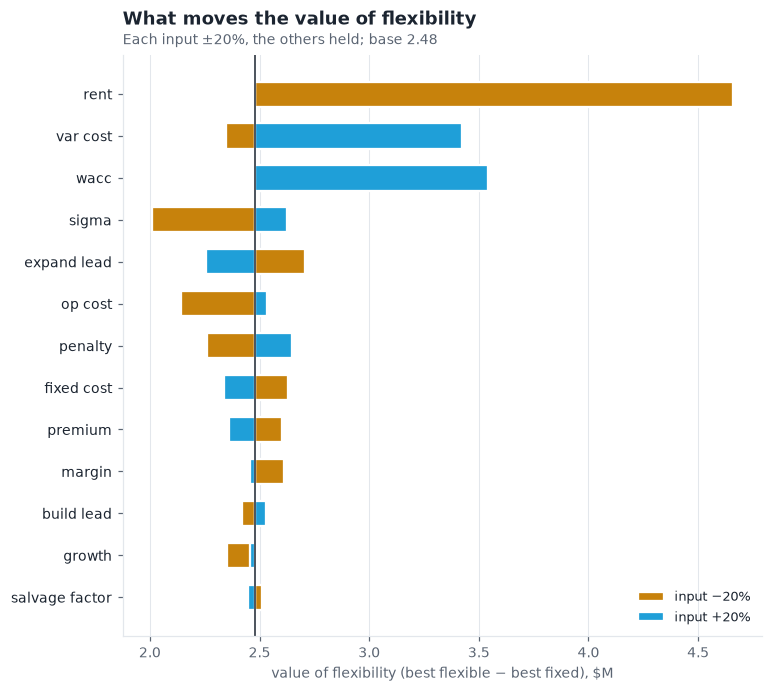

# Worked example: a regional distribution centre

A distributor serves a region through a third-party warehouse (3PL) and is deciding whether to open its own
distribution centre (DC). Five options are on the table: build the full design now, build the right size now, wait and
build later, build in phases, or lease with break clauses. This example goes from five years of monthly shipments to a
recommendation, a decision rule to monitor, and a check of what the recommendation depends on.

The numbers below come from [`examples/regional_dc.py`](../examples/regional_dc.py). Run it to reproduce them, and
replace its `HISTORY` with your own data to start your own case:

```
python examples/regional_dc.py --charts out/
```

## 1. Calibrate demand from the history

The history is 60 months of shipments, about 34,000 units a month in the last year, with a visible season.

```python
from supplyflex import calibrate

raw = calibrate.estimate(HISTORY, 12, scale=1000)
est = calibrate.estimate(HISTORY, 12, deseason=True, scale=1000)
```

| | Raw | Season removed |
|---|---|---|
| Volatility `sigma` | 0.312 | **0.247** (90%: 0.210 to 0.285) |
| Growth | — | −0.010 (90%: **−0.192 to +0.173**) |
| Demand today `d0` | — | 410 thousand units / year |

Two lessons before any valuation:

- **The season inflated volatility by about a quarter.** The raw estimate came with a warning ("the data look
  seasonal"). Seasonal swings are predictable and need no flexibility, so the de-seasoned 0.247 is the one to use.
- **The history says almost nothing about growth.** Its 90% interval runs from −19% to +17% a year. Volatility is
  pinned down by the number of observations; growth only by the length of the history. We use the commercial plan of
  **+4% a year** (inside the interval) and test the decision across the interval in step 5.



## 2. Value every strategy

The economics are the package defaults: a $20 margin per unit, $6 per unit of capacity a year to hold, $8M fixed plus
$30 per unit of capacity to build, an 18-month build, a 20-year life and an 8-year decision window. See the
[parameter reference](parameters.md) for each.

```python
from supplyflex import site

P = site.SiteParams(d0=est.d0, sigma=est.sigma, growth=0.04)
sol = site.solve(P)
```

| Strategy | NPV ($M) | Capacity (thousand units / year) |
|---|---|---|
| `stage`: build in phases | **20.47** | 328 now, then up to 389, 451, 512 or 574 |
| `lease` with break clauses | 18.95 | 362, breaks at years 5.5, 10.5, 15.5 |
| `best`: right size now | 17.99 | 451 |
| `defer`: wait, then build the full design | 17.87 | 574 when built |
| `full`: full design now | 16.42 | 574 |



Building in phases is worth **$2.48M more** than the best design built today, and $4.05M more than the full design
the plan would have built.

The option values need care:

| `option_values()` | $M | Reading |
|---|---|---|
| `stage` | +2.48 | phasing, against the right size now |
| `lease` | +0.96 | leasing, against the right size now |
| `break_clauses` | +1.18 | without its break clauses the lease would be worth less than building |
| `sell` | +0.64 | selling and mothballing together, for the right-size design |
| `mothball` | 0.00 | mothballing adds nothing once the site can be sold |
| `wait` | **−0.12** | waiting to build the *full* design is worse than building the *right* design now |

The negative `wait` does not mean waiting is worthless: waiting to build the full design is worth `defer − full` =
$1.45M more than building it now. The full design (574) is simply too big; waiting cannot fully repair that. The
values are measured against different baselines and **do not add up** (see the [guide](guide.md#option-values-sol-option_values)).

## 3. Read the decision rule

A phased strategy is only worth its value if someone executes the policy behind it. The staged site starts at 328,
and from that footprint it expands when demand reaches:

| From year | Demand (thousand units / year) | Expand to |
|---|---|---|
| 1.25 to 6.75 | about 760 to 860 | 574, the full design, in one step |
| 7 to 7.75 | about 670 to 760 | 574 |
| 8 (last chance) | 525 | 512 |

- **It jumps straight to the full design.** Each expansion carries a fixed charge (25% of a site's fixed cost), so one
  large step beats several small ones.
- **The bar is high: about twice today's demand.** Expanding is expensive (25% premium, one-year lead), and the 3PL
  absorbs moderate overflow in the meantime.
- **The bar drops at the end of the window.** With no later chance, a smaller margin of safety is enough.
- Each trigger is a range because neighbouring lattice steps sit on different demand
  levels, so the trigger read step by step alternates between two values; the true threshold lies between them.

In 3,000 simulated futures, 43% expand before year 8, another 9% at the last chance in year 8, and 48% never do.



This is the rule to monitor after the decision: track annualised demand against the line, not against the plan.

## 4. Look at the risk, not only the mean

| Strategy | Mean NPV | 5th percentile | Chance of a loss |
|---|---|---|---|
| `full` | 16.09 | −10.84 | 25% |
| `best` | 17.84 | −6.00 | 14% |
| `defer` | 17.65 | −4.30 | 9% |
| `stage` | **20.27** | −0.77 | 6% |
| `lease` | 18.95 | **+3.25** | **2%** |



Phasing has the highest mean and cuts the chance of a loss from 14% to 6%. Leasing gives up $1.3M of mean for the
safest profile: a loss in only 2% of futures, because the break clauses let it walk away. If the business cannot
absorb a loss on this project, the lease is a defensible choice; otherwise phasing is.

## 5. Test what the answer depends on

**Growth** decides the strategy. Re-solving across the plausible range, with everything else held:

| Planned growth | −4% | 0% | +2% | **+4%** | +6% | +8% | +10% | +12% |
|---|---|---|---|---|---|---|---|---|
| Highest value | lease | lease | lease | **stage** | stage | stage | best | best |

- Below about **+2%**, leasing wins: the downside dominates, and the break clauses are worth most.
- Above about **+9%**, building the right size now wins. That is partly structural: the staged site cannot exceed the
  full design (574), while the fixed design can be sized freely (693 at +10% growth, 820 at +12%). If high growth
  is plausible, raise `big_factor` and re-solve before concluding.
- **Volatility** does not change the answer: at both ends of its interval (0.210 and 0.285), phasing still wins.
- **The valuation basis** does not change it either: on the risk-neutral basis (`basis="rn"`) with a risk price of 0,
  0.1 or 0.3, phasing still has the highest value.

**The other inputs**: the tornado moves each input ±20% and shows how far the value of flexibility moves.



Rent matters most: at 20% lower rent the lease is worth $22.65M, $4.66M more than the best design built now and
$2.18M more than phasing. A firm rent quote is worth getting before deciding. Note that the tornado's ±20% is *relative*: for growth it spans
only 3.2% to 4.8%, which is why growth looks unimportant there while the sweep above shows it is decisive. Use the
calibration intervals, not ±20%, for inputs as uncertain as growth.

## 6. The recommendation

- **Build in phases**: a 328-thousand-unit DC now, designed so it can be extended to 574 in one step.
- **Expand to the full design** if annualised demand reaches about 760–860 thousand units before year 7 (670–760 in
  year 7), or to 512 if it reaches 525 at the end of the window.
- **Get a rent quote**: at 20% below the assumed rent, leasing beats building.
- **The decision depends on growth.** If the business's honest view of growth is below about 2% a year, lease instead.
  If it is above about 9%, re-solve with a larger full design before choosing to build big now.

## Where to go next

- A second region: `network.solve(...)` values one hub or two, a pilot hub with the option on the second, and waiting;
  `plots.pooling(params)` shows how the regions' correlation changes the answer.
- Every input: the [parameter reference](parameters.md).
- How to read the results, and what the model leaves out: the [user guide](guide.md).
